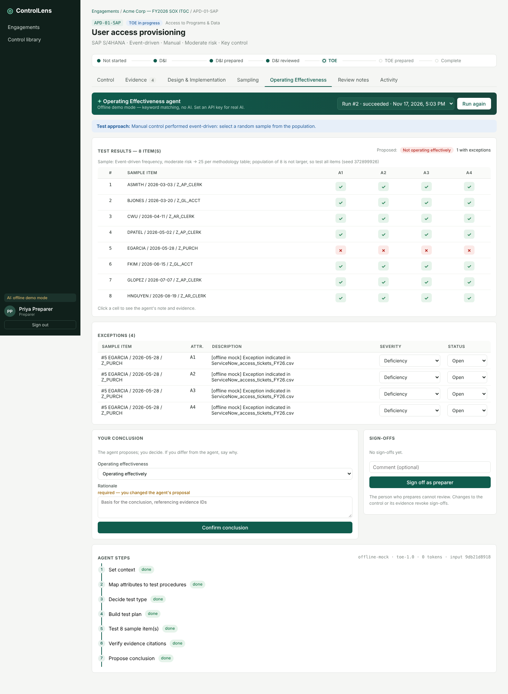
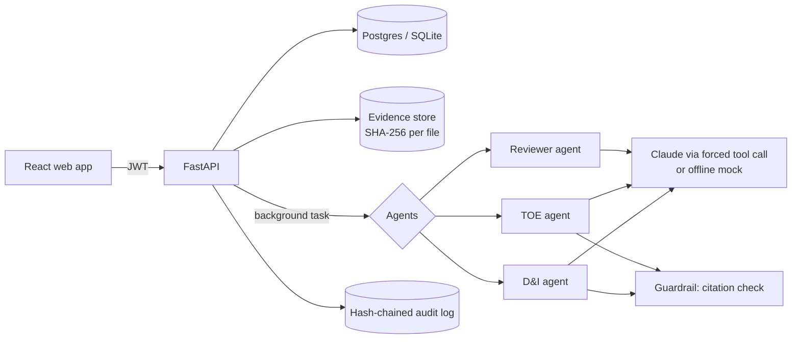
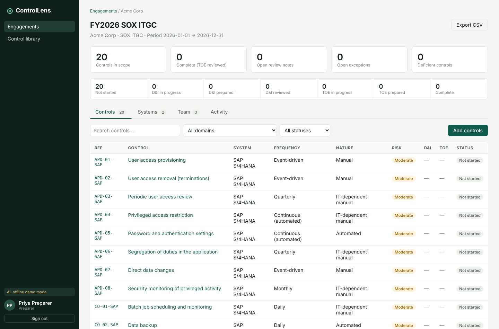
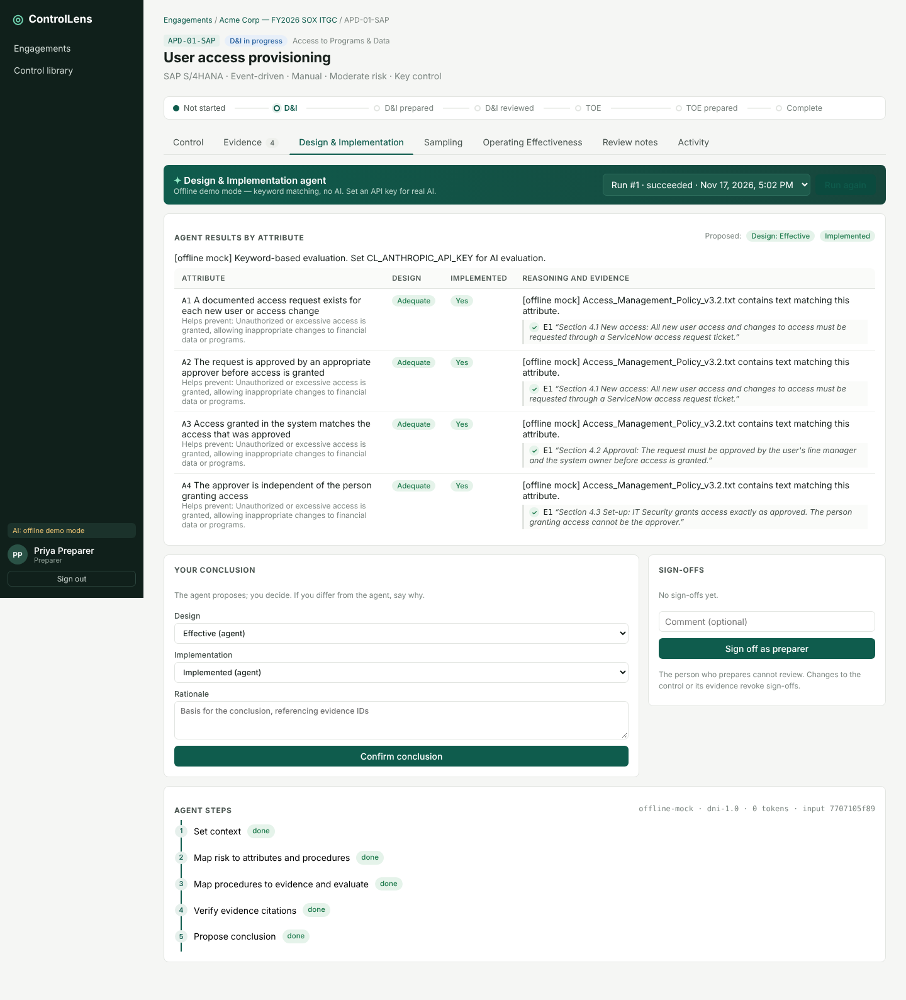

# ControlLens: agentic ITGC testing platform


ControlLens tests IT general controls (ITGC) with AI agents. The agents draft the work and people make the decisions. Every claim an agent makes has to point to a quote in the evidence, and the platform checks that the quote is really there.



Version 1 covers all four ITGC domains:

| Domain | Controls in library |
|---|---|
| APD: Access to Programs & Data | Provisioning, terminations, access review, privileged access, passwords/MFA, SoD, direct data changes, privileged activity monitoring |
| PC: Program Change | Change approval, testing, dev/prod separation, emergency changes, configuration monitoring |
| CO: Computer Operations | Batch jobs, backups, incidents, interfaces |
| PD: Program Development | New system approval, data migration, post-implementation review |

---

## Quick start (local, about 5 minutes)

You need Python 3.11+ and Node 20+.

```bash
# 1. Back end
cd backend
pip install -r requirements.txt
cp ../.env.example .env          # add CL_ANTHROPIC_API_KEY for real AI (optional)
uvicorn app.main:app --reload --port 8000

# 2. Front end (new terminal)
cd frontend
npm install
npm run dev                      # opens http://localhost:5173
```

The first time it starts, it creates a demo engagement called **Acme Corp FY2026 SOX ITGC**. It has 20 SAP controls, and APD-01 already has evidence attached.

| Login | Password | Role |
|---|---|---|
| priya.preparer@controllens.local | Demo#12345 | Preparer |
| ravi.reviewer@controllens.local | Demo#12345 | Reviewer |
| maya.manager@controllens.local | Demo#12345 | Manager |
| admin@controllens.local | Admin#12345 | Admin |

**Without an API key**, the agents run in *offline demo mode*. This mode matches keywords instead of using AI, and the side bar shows it. **With a key**, the agents call Claude.

### Run with Docker (Postgres + app in one command)

```bash
echo "CL_JWT_SECRET=$(openssl rand -hex 32)" > .env
echo "CL_ANTHROPIC_API_KEY=sk-ant-..." >> .env
docker compose up --build        # http://localhost:8000
```

### Run tests

```bash
cd backend && pytest -q
```

---

## Demo walkthrough (APD-01 User access provisioning)

1. Sign in as **Preparer**, then open the engagement and then **APD-01-SAP**.
2. **Design & Implementation**: click *Run agent*. It maps risk → attributes → procedures → evidence, checks every quote, and proposes a conclusion. Confirm it, then *Sign off as preparer*.
3. Sign in as **Reviewer**. Open the same control and *Sign off as reviewer*. The preparer can't do this step (segregation of duties).
4. As Preparer, go to **Sampling** and pick `SAP_new_users_FY26.csv`. The platform works out the sample size and records the seed.
5. **Operating Effectiveness**: run the agent. It tests each sample item against each attribute and finds the planted exception: EGARCIA's access was granted before the owner approved it.
6. **Review notes**: run the reviewer agent. It raises notes, for example "TOE conclusion not confirmed".
7. **Audit trail** (manager): click *Verify integrity* to check the hash chain.

---

## How it works



### The agents

| Agent | Steps | What is AI, what is code |
|---|---|---|
| **D&I** | Set context → Map risk to attributes & procedures → Map procedures to evidence & evaluate → Verify citations → Propose conclusion | AI writes the plan and the evaluation. Code checks the citations and does the roll-up. |
| **TOE** | Set context → Map attributes to test steps → Decide test type → Build test plan → Test each sample item (batches of 8) → Verify citations → Propose conclusion | AI writes the test steps and tests each item. **Code decides** the test type and sample, records exceptions, and does the roll-up. |
| **Reviewer** | Quality rules → AI review of the work papers → Raise review notes | Rules catch evidence that changed after a run, small samples, missing population, unconfirmed conclusions, and exceptions that conflict with the conclusion. |

### Guardrails (why you can trust the output)

- **Structured output only.** Every AI call is a forced tool call with a JSON schema. If the output is malformed, the call is retried.
- **Citation check.** Each cited quote must appear word for word in the cited evidence file. If not, the claim is flagged.
- **Unsupported claims are downgraded.** A "pass" or "adequate" without verified evidence becomes "unable to assess".
- **Math in code, not AI.** Sample size, random selection (seeded, so anyone can repeat it), and the final roll-up.
- **Agents never sign off.** A person confirms each conclusion. If they change the agent's answer, they must give a reason, and it is logged.
- **Full run record.** Each run stores the model, prompt version, input hash, evidence IDs, every step's output, token counts and flags.

### Enterprise controls built in

- **Roles:** viewer, preparer, reviewer, manager, admin. Engagement membership controls who sees what.
- **Segregation of duties:** the person who prepared a stage can't review it. Open review notes block the reviewer sign-off.
- **Sign-off revocation:** if the control, its evidence, its sample or an exception changes, the sign-offs it relied on are revoked automatically.
- **Tamper-evident audit trail:** each row's hash includes the previous row's hash, and `/api/audit/verify` checks the whole chain.
- **Evidence integrity:** a SHA-256 hash is stored on upload and checked again on download. Duplicate files are blocked, only allowed file types and sizes are accepted, and removed files are soft-deleted.
- **Safe concurrent editing:** if two people edit the same control, the second save is rejected.
- **Login security:** bcrypt passwords, a password strength rule, and lockout after 5 failed tries.
- **Engagement lock:** once a manager locks an engagement, its work papers are read-only.
- **Operations:** request IDs, JSON logs, security headers, a health check, and runs stuck by a restart are marked failed. Runs in Docker as a non-root user with Postgres.

---

## Screenshots

| Engagement dashboard | Design & Implementation agent |
|---|---|
|  |  |
| **Operating Effectiveness agent** | **Tamper-evident audit trail** |
|  |  |

---

## Folder map

```
backend/app/
  library.py          ITGC control library (20 controls, attributes, procedures, evidence)
  sampling.py         sampling methodology table + seeded selection
  agents/
    llm.py            Claude client (forced tool use, retries) + offline mock
    prompts.py        versioned prompts
    common.py         evidence packing, citation verification
    dni.py toe.py reviewer.py   the three agents
    runner.py         step recorder (saves each step as it runs)
  workflow.py         sign-offs, SoD, revocation
  audit.py            hash-chained audit log
  routers/            REST API (auth, engagements, controls, audit)
frontend/src/pages/   Login, Engagements, Engagement, ControlWorkspace, Library, Audit, Users
```

API docs (Swagger) are at `http://localhost:8000/docs` when the server is running.

---

## Before a real client rollout (next steps)

Version 1 is a solid base. Before you put real client data in it, add these:

1. **SSO** (Azure AD / Okta via OIDC) and MFA, in place of local passwords.
2. **Database migrations** with Alembic. Today, tables are created on start.
3. **Job queue** (Celery, Arq, or Azure Service Bus) for agent runs, so you can run many workers and have runs survive restarts.
4. **Evidence storage** in Azure Blob or S3 with encryption at rest, and a malware scan on upload.
5. **OCR** for scanned PDFs and screenshots, plus vision input to the model.
6. **Multi-tenant isolation** (one firm, many clients) and retention / legal-hold rules.
7. **Exports**: a signed PDF work paper for each control and a deficiency summary.
8. **AI evaluation set**: a few gold-standard controls with known answers, re-run whenever a prompt changes.
9. **Security review**: pen test, rate limits, and secrets in a key vault.
10. **More frameworks** after ITGC: business process controls (P2P, O2C, R2R), SOC 1/2 mapping, and continuous monitoring.

Sample sizes follow common ITGC practice (see `sampling.py`). Swap in your own methodology table.
