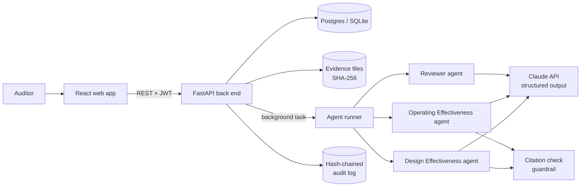
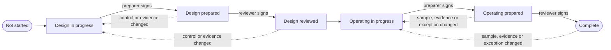
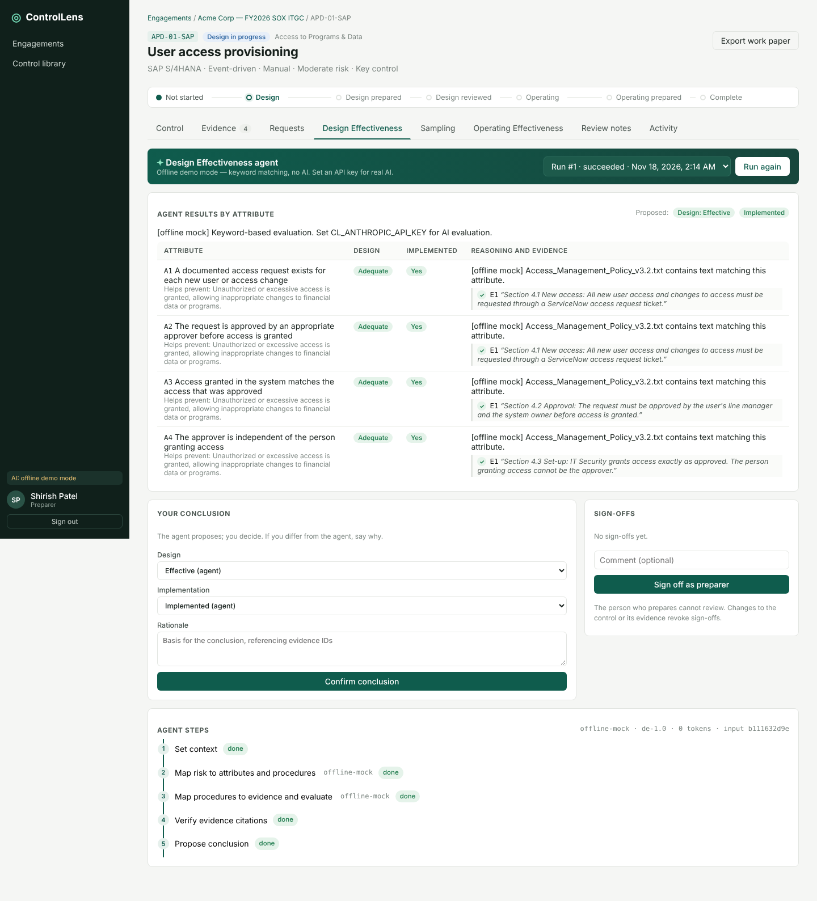
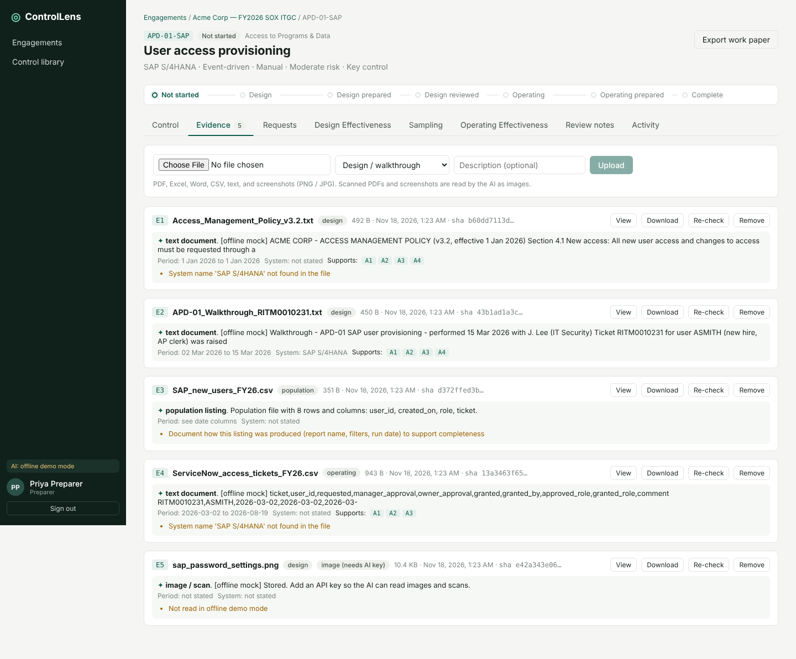
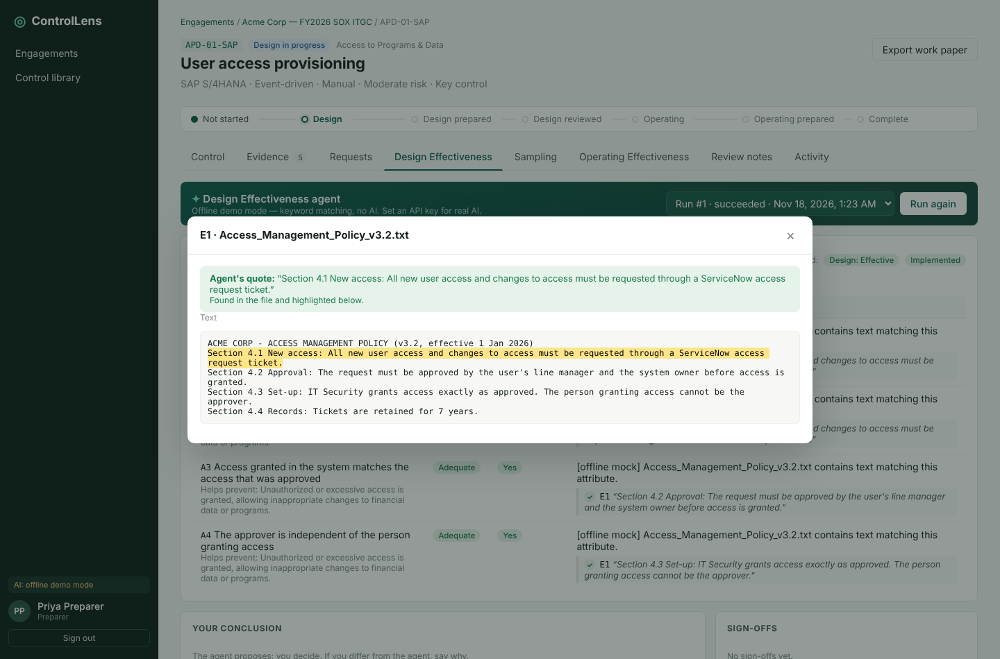
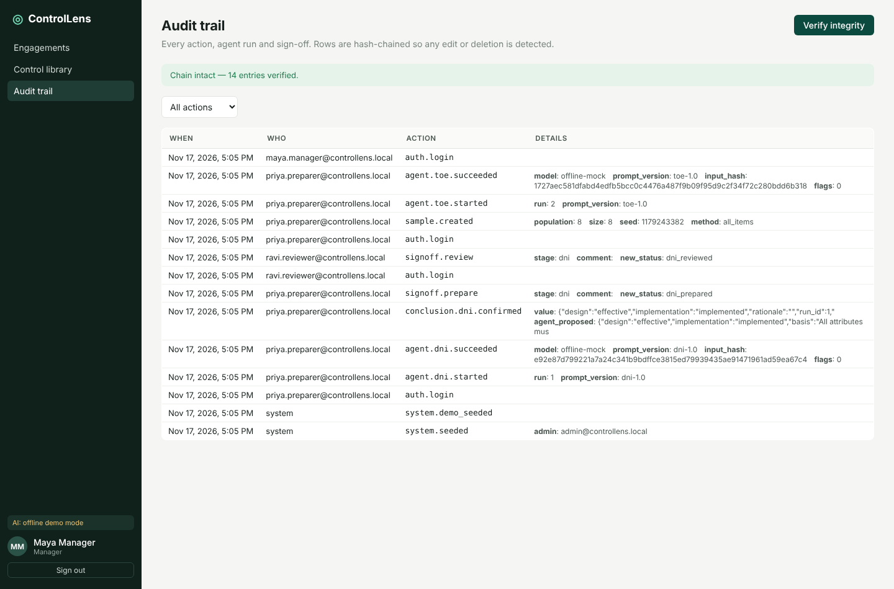

<div align="center">

# ◎ ControlLens

**Agentic AI platform for IT general control (ITGC) testing**

AI agents draft the audit work. People make the decisions. Every claim is tied to the evidence.


[Launch it](#launch-it-online) · [Quick start](#quick-start) · [Demo](#demo-walkthrough) · [Architecture](docs/ARCHITECTURE.md) · [Agents](docs/AGENTS.md) · [API](docs/API.md) · [Security](docs/SECURITY.md) · [Deploy](docs/DEPLOYMENT.md)


</div>

---

## Contents

- [Why ControlLens](#why-controllens)
- [Features](#features)
- [How it works](#how-it-works)
- [Quick start](#quick-start)
- [Demo walkthrough](#demo-walkthrough)
- [Screenshots](#screenshots)
- [Tech stack](#tech-stack)
- [Project structure](#project-structure)
- [Documentation](#documentation)
- [Roadmap](#roadmap)
- [License](#license)

---

## Why ControlLens

Testing ITGCs is slow and repetitive. Each control needs the same steps: understand the risk, check the design, pick a sample, test each item against each attribute, write it up, and get it reviewed. Most of the time goes into reading evidence and writing the same kind of notes again and again.

Plain AI chat tools don't fix this for audit work, because their answers can't be traced. An auditor can't sign off on "the AI said so."

ControlLens is built around three rules:

1. **Every claim cites evidence.** Agents must quote the evidence file. The platform checks the quote is really in that file. If it isn't, the claim is flagged and downgraded.
2. **Code does the math.** Sample sizes, random selection and final roll-ups are calculated by code, so anyone can repeat them. AI never decides how many items to test.
3. **People decide.** Agents only propose. A person confirms each conclusion and signs off. If they change the agent's answer, they must say why, and that is logged.

---

## Features

### Control library: 20 ITGCs across all 4 domains

| Domain | Controls |
|---|---|
| **APD**: Access to Programs & Data | User provisioning · Terminations · Access review · Privileged access · Passwords / MFA · Segregation of duties · Direct data changes · Privileged activity monitoring |
| **PC**: Program Change | Change approval · Change testing · Dev / prod separation · Emergency changes · Configuration monitoring |
| **CO**: Computer Operations | Batch jobs · Backups · Incident management · Interface monitoring |
| **PD**: Program Development | New system approval · Data migration · Post-implementation review |

Each control comes with its **attributes**, **Design procedures**, **Operating procedures** and **evidence to request**. Teams copy controls into an engagement for each in-scope system, then tailor them.

### Three AI agents

The agents follow the two standard SOX / PCAOB AS 2201 testing stages, design effectiveness (DE) and operating effectiveness (OE), plus a review stage.

| Agent | What it does |
|---|---|
| **Design Effectiveness (DE)** | Maps risk to attributes, then to procedures, then to evidence. Judges whether each attribute is well designed and actually in place. Lists gaps and evidence to request. |
| **Operating Effectiveness (OE)** | Tests every sample item against every attribute, in batches. Logs exceptions with the exact reason (for example, "access granted 28-May, owner approval 30-May"). |
| **Reviewer** | Runs quality rules and an AI review of the work papers. Raises review notes, which block the reviewer's sign-off until they are closed. |

### Reads real evidence

- **Screenshots and scanned PDFs** are sent to the AI as images, so it can read system settings screens, approval emails and signed forms.
- **Intake check on every upload**: within seconds the agent says what the file is, the period and system it covers, which attributes it supports, and any quality problems (no date, no system name, cut-off screenshot).
- **Click any quote** in an agent's result to open the evidence file with that quote highlighted.

### Audit workflow

- **Evidence request list (PBC)**: drafted from the Design agent's gaps, tracked per control and across the engagement, with a CSV export for the client
- **Work paper export**: one printable file per control with evidence hashes, results, quotes, sample, exceptions and sign-offs

- **Engagements** with in-scope systems (application, database, OS layers) and team members
- **Evidence** upload: PDF, Excel, CSV, Word, text and images, with text pulled out automatically
- **Sampling engine**: frequency- and risk-based sample size, seeded random selection, override with reason
- **Exceptions** tracked by severity: deficiency, significant deficiency, material weakness
- **Preparer → reviewer sign-off** for both DE and OE
- **Review notes** with respond, address and close
- **CSV export** of the engagement status

### Built for enterprise use

| Area | What's included |
|---|---|
| Access | 5 roles (viewer, preparer, reviewer, manager, admin), access by engagement membership |
| Segregation of duties | The preparer can't review their own work. Open review notes block review. |
| Integrity | Sign-offs are revoked automatically when the control, its evidence, its sample or an exception changes |
| Audit trail | Hash-chained log of every action, with a one-click integrity check |
| Evidence | SHA-256 hash on upload, checked on every download. File type and size limits. Soft delete only. |
| AI cost control | Choose a model for each kind of step. Limit on agent runs per user per hour. |
| Upgrades | Database migrations (Alembic) run on every start, so updates keep your data |
| AI traceability | Each run stores the model, prompt version, input hash, evidence used, every step's output and token counts |
| Data safety | Two people editing the same control can't overwrite each other's changes. Engagements can be locked. |
| Login | bcrypt passwords, strength rules, lockout after 5 failed tries, JWT sessions |
| Operations | Request IDs, JSON logs, security headers, health check, Docker + Postgres, CI |

---

## How it works



**Life of a control:**



For the full design, see **[docs/ARCHITECTURE.md](docs/ARCHITECTURE.md)**.

---

## Launch it online

[](https://render.com/deploy?repo=https://github.com/Shiripatel/controllens)

**Free trial run, no card:** [](https://codespaces.new/Shiripatel/controllens) starts the app in a private cloud machine on your GitHub account. Wait for setup to finish, then open port 8000 from the **Ports** tab. Sign in with `priya.preparer@controllens.local` / `Demo#12345`. It stops when idle, so use Render for an always-on link.

**Always on:** the Render button. One click sets up the app with a saved disk for the database and evidence (about $7–8 a month on Render). You'll be asked for three values:

| Value | What to enter |
|---|---|
| `CL_SEED_ADMIN_PASSWORD` | A password for `admin@controllens.local` |
| `CL_SEED_DEMO_PASSWORD` | A password for the three demo users (preparer, reviewer, manager) |
| `CL_ANTHROPIC_API_KEY` | Your Anthropic key for real AI. Leave empty for offline demo mode. |

Passwords need 10+ characters with upper case, lower case and a number. Details: [docs/DEPLOYMENT.md](docs/DEPLOYMENT.md#render).

---

## Quick start

### Option 1: Run locally (about 5 minutes)

You need **Python 3.11+** and **Node 20+**.

```bash
git clone https://github.com/<your-username>/controllens.git
cd controllens

# Back end
cd backend
pip install -r requirements.txt
cp ../.env.example .env           # optional: add CL_ANTHROPIC_API_KEY
uvicorn app.main:app --reload --port 8000
```

In a second terminal:

```bash
cd frontend
npm install
npm run dev                        # open http://localhost:5173
```

### Option 2: Docker (app + Postgres)

```bash
echo "CL_JWT_SECRET=$(openssl rand -hex 32)" > .env
echo "CL_ANTHROPIC_API_KEY=sk-ant-..." >> .env    # optional
docker compose up --build                          # open http://localhost:8000
```

### AI mode

| `CL_ANTHROPIC_API_KEY` | What runs |
|---|---|
| Not set | **Offline demo mode.** Agents use simple keyword matching so you can try the full flow with no AI cost. The side bar shows "offline demo mode". |
| Set | **Claude.** Agents call the model with structured output and the full guardrails. |

### Demo logins

On first start, the app creates a demo engagement called **Acme Corp FY2026 SOX ITGC**. It has 20 SAP controls, and sample evidence is attached to APD-01.

| Role | Email | Password |
|---|---|---|
| Preparer | `priya.preparer@controllens.local` | `Demo#12345` |
| Reviewer | `ravi.reviewer@controllens.local` | `Demo#12345` |
| Manager | `maya.manager@controllens.local` | `Demo#12345` |
| Admin | `admin@controllens.local` | `Admin#12345` |

> Change or turn off demo users (`CL_SEED_DEMO=false`) before any real use.

### Run tests

```bash
cd backend && pytest -q
```

---

## Demo walkthrough

Use control **APD-01 · User access provisioning**.

| # | Who | Where | What happens |
|---|---|---|---|
| 1 | Preparer | Design Effectiveness | Click **Run agent**. Watch it go through 5 steps. Each attribute gets a result with quoted evidence and a ✓ if the quote is verified. |
| 2 | Preparer | same | **Confirm conclusion**, then **Sign off as preparer**. |
| 3 | Reviewer | same | **Sign off as reviewer**. Try it as the preparer: it's blocked by segregation of duties. |
| 4 | Preparer | Sampling | Pick `SAP_new_users_FY26.csv` and click **Select sample**. The size comes from the methodology table, and the seed is saved. |
| 5 | Preparer | Operating Effectiveness | **Run agent**. It tests 8 users × 4 attributes and catches EGARCIA: access was granted before the owner approved it. |
| 6 | Reviewer | Review notes | Run the **Reviewer agent**. It raises notes such as "Operating conclusion not confirmed". |
| 7 | Preparer | Evidence | Upload any new design file. The Design sign-offs are revoked automatically. |
| 8 | Manager | Audit trail | Click **Verify integrity** to check the hash chain. |

---

## Screenshots

| Engagement dashboard | Design Effectiveness agent |
|---|---|
|  |  |
| **Evidence intake check** | **Click a quote to see it in the file** |
|  |  |
| **Operating Effectiveness agent** | **Tamper-evident audit trail** |
|  |  |

---

## Tech stack

| Layer | Choice | Why |
|---|---|---|
| Front end | React 19, TypeScript, Vite, React Router | Fast, typed, no heavy UI library |
| Back end | Python, FastAPI, Pydantic | Typed API with automatic OpenAPI docs |
| Database | SQLAlchemy 2 on Postgres (prod) or SQLite (dev) | Same code for both |
| AI | Anthropic Claude through forced tool use | Answers always match a JSON schema |
| Documents | pypdf, openpyxl, built-in DOCX reader | Pull text out of evidence |
| Auth | JWT (PyJWT), bcrypt | Standard and simple to swap for SSO |
| Delivery | Docker, docker compose, GitHub Actions | One image serves the API and the web app |

---

## Project structure

```
controllens/
├── backend/
│   ├── app/
│   │   ├── main.py            App start-up, middleware, static web app
│   │   ├── config.py          Settings (env vars, CL_ prefix)
│   │   ├── db.py · models.py  Database and tables
│   │   ├── library.py         ITGC control library (20 controls)
│   │   ├── sampling.py        Sample size table and seeded selection
│   │   ├── extraction.py      Text from PDF / Excel / Word / CSV
│   │   ├── workflow.py        Sign-offs, segregation of duties, revocation
│   │   ├── audit.py           Hash-chained audit log
│   │   ├── security.py        Passwords, tokens, roles
│   │   ├── seed.py            First-start admin and demo data
│   │   ├── agents/
│   │   │   ├── llm.py         Claude client + offline mock
│   │   │   ├── prompts.py     Versioned prompts
│   │   │   ├── common.py      Evidence packing, citation checks
│   │   │   ├── runner.py      Records each step as it runs
│   │   │   └── design.py · operating.py · reviewer.py
│   │   └── routers/           auth · engagements · controls · audit_log
│   └── tests/                 End-to-end workflow and AI client tests
├── frontend/src/
│   ├── api.ts                 API client and labels
│   ├── components/ui.tsx      Shared UI pieces
│   └── pages/                 Login · Engagements · Engagement · ControlWorkspace · Library · AuditLog · Users
├── docs/                      Architecture, agents, API, data model, security, deployment
├── Dockerfile · docker-compose.yml
└── .github/workflows/ci.yml
```

---

## Documentation

| Document | What's inside |
|---|---|
| [Architecture](docs/ARCHITECTURE.md) | System design, components, request flow, key design choices |
| [Agents](docs/AGENTS.md) | Each agent step by step, prompts, guardrails, offline mode, how to add an agent |
| [Data model](docs/DATA-MODEL.md) | Tables, relationships, statuses |
| [API reference](docs/API.md) | All endpoints with roles and examples |
| [Security](docs/SECURITY.md) | Roles, segregation of duties, audit trail, evidence integrity, known gaps |
| [Deployment](docs/DEPLOYMENT.md) | Settings, Docker, Postgres, production checklist |
| [Methodology](docs/METHODOLOGY.md) | ITGC domains, sampling table, conclusion rules |
| [Roadmap](docs/ROADMAP.md) | What's next |
| [Contributing](CONTRIBUTING.md) | How to set up, test and submit changes |
| [Changelog](CHANGELOG.md) | Release history |

Interactive API docs (Swagger) are at `http://localhost:8000/docs` when the server is running.

---

## Roadmap

- [x] ITGC library, DE / OE / Reviewer agents, sampling, sign-offs, audit trail
- [ ] SSO (Azure AD / Okta) and MFA
- [x] Alembic database migrations
- [x] Screenshot and scanned-PDF reading, intake check, citation viewer
- [x] Evidence request list, work paper export, model per step
- [ ] Job queue for agent runs (scale out, survive restarts)
- [ ] Cloud evidence storage with encryption and malware scan
- [ ] Business process controls (P2P, O2C, R2R) and SOC 1 / SOC 2 mapping

Full list: [docs/ROADMAP.md](docs/ROADMAP.md)

---

## License

[MIT](LICENSE) © 2026 Shirish Patel

> **Disclaimer.** ControlLens supports auditors and does not replace professional judgement. Conclusions, sign-offs and opinions remain the responsibility of the engagement team.
