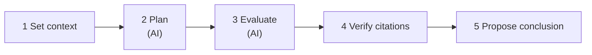
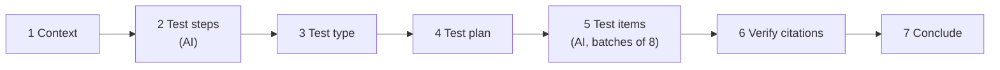

# Agents

ControlLens has three agents. Each one runs as a list of **steps**. Some steps call the AI model. Others are plain code. Each step's output is saved as soon as it finishes, so you can see exactly what the agent did and why.

- [Models used in each step](#models-used-in-each-step)
- [D&I agent](#1-design--implementation-di-agent)
- [TOE agent](#2-test-of-operating-effectiveness-toe-agent)
- [Reviewer agent](#3-reviewer-agent)
- [Guardrails](#guardrails)
- [How the model is called](#how-the-model-is-called)
- [Prompts and versions](#prompts-and-versions)
- [Offline demo mode](#offline-demo-mode)
- [What a run stores](#what-a-run-stores)
- [Adding a new agent](#adding-a-new-agent)

---

## Models used in each step

All AI steps use one model, set by `CL_LLM_MODEL` (default `claude-sonnet-5-5`). Every other step is code, so the numbers and roll-ups are always repeatable.

| Agent | # | Step | Runs on |
|---|---|---|---|
| D&I | 1 | Set context | Code |
| D&I | 2 | Map risk → attributes → procedures | **AI** |
| D&I | 3 | Map procedures → evidence and evaluate | **AI** |
| D&I | 4 | Verify evidence citations | Code |
| D&I | 5 | Propose conclusion | Code |
| TOE | 1 | Set context | Code |
| TOE | 2 | Map attributes → test procedures | **AI** |
| TOE | 3 | Decide test type | Code |
| TOE | 4 | Build test plan from the sample | Code |
| TOE | 5 | Test each sample item (8 items per call) | **AI** |
| TOE | 6 | Verify evidence citations | Code |
| TOE | 7 | Propose conclusion | Code |
| Reviewer | 1 | Run quality rules | Code |
| Reviewer | 2 | Review work papers | **AI** |
| Reviewer | 3 | Raise review notes | Code |

**AI calls per run:** D&I = 2 · TOE = 1 + (sample size ÷ 8, rounded up) · Reviewer = 1.
For example, a TOE run on 25 items makes 1 + 4 = 5 calls.

The model actually used is saved on every run (`agent_runs.model`) and in the audit log.

---

## 1. Design & Implementation (D&I) agent

**Question it answers:** Is the control designed well enough to address the risk, and was it actually in place?

File: `backend/app/agents/dni.py` · Prompt version: `dni-1.0`



| # | Step | Input | Output |
|---|---|---|---|
| 1 | Set context | Control, system, evidence list | Summary, plus a warning if no evidence was uploaded. Stops if the control has no attributes. |
| 2 | Plan | Control + standard D&I procedures | For each attribute: how it addresses the risk, and the procedures to use. Can suggest missing attributes. |
| 3 | Evaluate | Control + plan + all evidence text | For each attribute: `design_assessment` (adequate / inadequate / unable_to_assess), `implemented` (yes / no / unable_to_assess), procedure → evidence map, citations, reasoning. Also gaps and evidence to request. |
| 4 | Verify citations | Step 3 output + evidence | Each citation marked verified ✓ / not found ✗ / can't check ?. Unsupported "adequate" or "yes" is downgraded. Attributes the AI skipped are added as "unable to assess". |
| 5 | Propose conclusion | Attribute results | **Design:** any inadequate → *not effective*; any unable → *needs more evidence*; else *effective*. **Implementation:** same logic. |

---

## 2. Test of Operating Effectiveness (TOE) agent

**Question it answers:** Did the control work for every sampled item, all through the period?

File: `backend/app/agents/toe.py` · Prompt version: `toe-1.0`



| # | Step | Output |
|---|---|---|
| 1 | Set context | Flags it if D&I isn't reviewed yet (TOE still runs, but the result may need rework) |
| 2 | Map attributes to test procedures | For each attribute: exact test steps and what counts as a pass |
| 3 | Decide test type | *Automated / continuous* → test of one. *Everything else* → random sample. ([Methodology](METHODOLOGY.md)) |
| 4 | Build test plan | Uses the saved sample (size, seed, items). Stops with a clear message if a sample is needed but none was selected. |
| 5 | Test sample items | For each item × attribute: pass / fail / unable_to_assess, with note and citations. Runs 8 items per AI call. |
| 6 | Verify citations | Same check as D&I. A pass without verified evidence becomes *unable to assess*. Items the AI skipped are flagged. |
| 7 | Propose conclusion | Any fail → *not operating effectively*. Any unable → *needs more evidence*. Else *operating effectively*. Each fail is saved as an **exception** record. |

Earlier agent-raised open exceptions are replaced on each run. Exceptions a person has accepted or marked remediated are kept.

---

## 3. Reviewer agent

**Question it answers:** Would a manager sign this off? If not, what needs fixing?

File: `backend/app/agents/reviewer.py` · Prompt version: `rev-1.0`

| # | Step | What it does |
|---|---|---|
| 1 | Quality rules (code) | Checks: no D&I run · evidence changed since the last run · guardrail flags not resolved · conclusion not confirmed · no sample · sample below methodology size · population file not linked · open exceptions but conclusion says "effective" |
| 2 | AI review | Reads the work papers and evidence. Raises notes only where there is a real issue: unsupported conclusions, wrong period or system, unclear exceptions, unclear wording. |
| 3 | Raise notes | Saves the notes as review notes (`source = reviewer_agent`). Skips notes that are already open with the same text. |

Open review notes **block** the reviewer's sign-off. Only a person with reviewer role or higher can close them.

---

## Guardrails

| Guardrail | Where | What happens |
|---|---|---|
| Schema-forced output | Every AI call | The model must call a tool whose input matches a JSON schema. Missing required fields → retry (up to 3 tries). |
| Evidence-only rule | System prompt | The model is told to use only the evidence given, cite every claim, and say "unable_to_assess" instead of guessing. |
| Citation check | D&I step 4, TOE step 6 | Each excerpt is compared, ignoring spacing and case, with the cited file's text. Citing a file that isn't on the control → `unknown_evidence` flag. Quote not found → `excerpt_not_found` flag. |
| Downgrade | Same | "Adequate", "yes" or "pass" without at least one verified citation → *unable to assess* (`unsupported_conclusion` flag). |
| Coverage check | Same | Attributes or sample items the AI didn't return → flagged and treated as not assessed. |
| Code-only math | TOE steps 3, 4, 7 | Test type, sample and roll-up never come from the AI. |
| Human decision | `/conclusion` API | Agents never write the final conclusion. Changing the agent's proposal needs a reason (15+ characters). |

Guardrail flags are shown on the run, counted in the audit log, and picked up by the reviewer agent.

---

## How the model is called

File: `backend/app/agents/llm.py`

```python
client.messages.create(
    model=settings.llm_model,                 # CL_LLM_MODEL
    max_tokens=settings.llm_max_tokens,       # CL_LLM_MAX_TOKENS
    system=<versioned prompt>,
    tools=[{"name": ..., "input_schema": <JSON schema>}],
    tool_choice={"type": "tool", "name": ...},  # forces structured output
    messages=[{"role": "user", "content": <control + evidence>}],
)
```

- **Evidence packing:** each file is wrapped in `<evidence id="E12" file="..." purpose="...">`. Files share a budget of `CL_MAX_EVIDENCE_CHARS` (default 60,000 characters per call), split evenly. Cut text is marked `[truncated]`.
- **Retries:** the SDK retries network errors 3 times. The platform retries bad output up to 2 more times.
- **Timeout:** 180 seconds per call.

---

## Prompts and versions

All prompts are in `backend/app/agents/prompts.py`. They share one set of base rules:

- Use only the evidence provided.
- Every "met" claim cites an evidence ID with a word-for-word excerpt.
- If evidence is missing or unclear, say `unable_to_assess` and list what's needed.
- Write in plain business English, with specific names, dates and ticket numbers.
- You propose; a person decides.

**When you change a prompt, change its version** (for example `toe-1.0` → `toe-1.1`). Every run saves the version, so you can always tell which instructions produced a result.

---

## Offline demo mode

If `CL_ANTHROPIC_API_KEY` is empty (or `CL_LLM_PROVIDER=mock`), each AI step uses a simple stand-in:

- **D&I:** finds evidence lines that share keywords with each attribute.
- **TOE:** finds evidence lines that contain the sample item's values (for example user ID or ticket number). A line with words like "late", "missing" or "not approved" counts as a fail.
- **Reviewer:** runs the quality rules only.

The mock's answers go through the same guardrails, so the full workflow can be demoed and tested in CI. Results are marked `[offline mock]`.

---

## What a run stores

Table `agent_runs` (see [DATA-MODEL.md](DATA-MODEL.md)):

| Field | Example |
|---|---|
| `agent` | `toe` |
| `status` | `queued` → `running` → `succeeded` / `failed` |
| `provider`, `model` | `anthropic`, `claude-sonnet-5-5` |
| `prompt_version` | `toe-1.0` |
| `input_hash` | SHA-256 of prompt version + control + evidence hashes |
| `evidence_ids` | `[1, 2, 3, 4]` |
| `steps` | List of `{key, title, status, started, finished, output, error}` |
| `result` | Final structured result, including `proposed_conclusion` |
| `guardrail_flags` | List of `{type, where, detail}` |
| `input_tokens`, `output_tokens` | Totals for the run |

---

## Adding a new agent

1. Create `backend/app/agents/<name>.py` with a `run(ctx: RunContext) -> dict` function.
2. Split the work into `ctx.step("key", "Title", fn)` calls. Return an `LLMResult` from a step to have tokens and model counted.
3. Add the prompt and a version string to `prompts.py`.
4. Register it in `AGENTS` in `routers/controls.py`.
5. Add a mock function so it works offline, and a test in `backend/tests/`.
