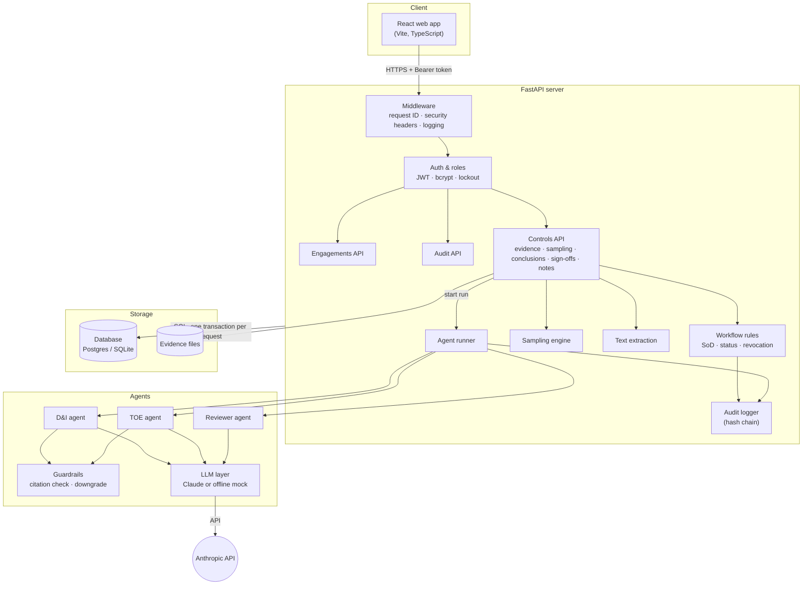
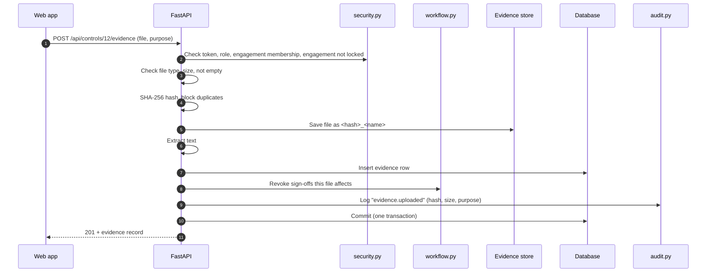
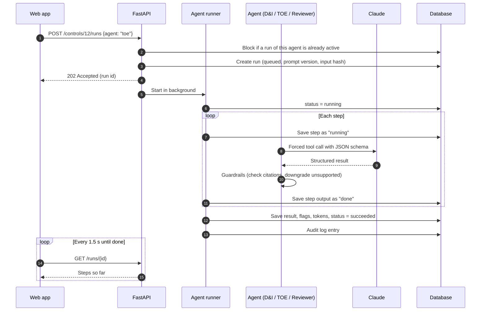
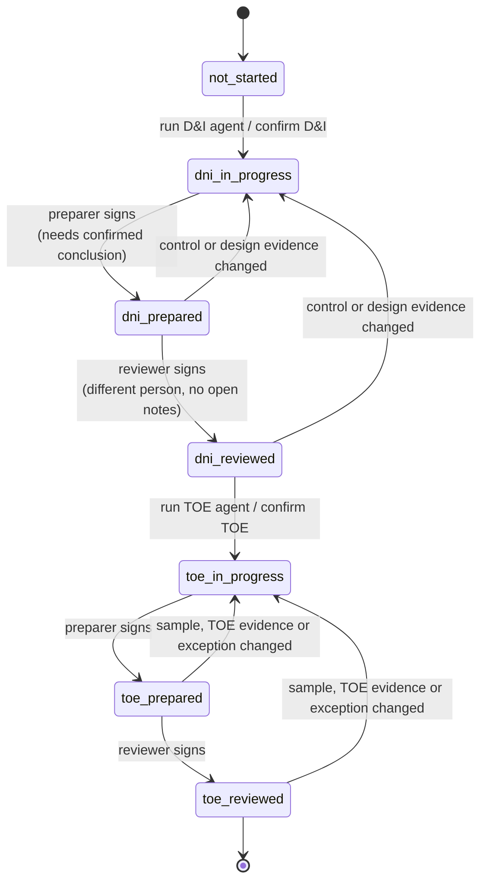
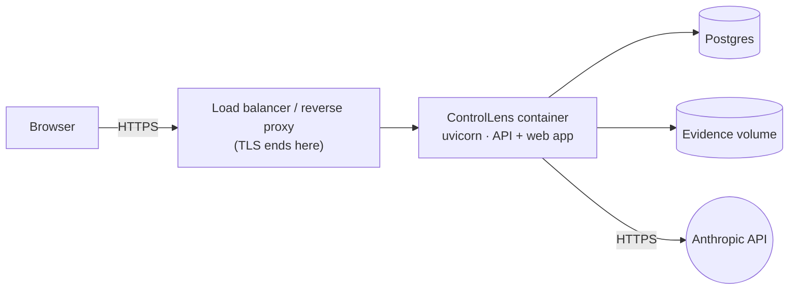

# Architecture

This page explains how ControlLens is built and why it is built that way.

- [1. Big picture](#1-big-picture)
- [2. Components](#2-components)
- [3. How a request flows](#3-how-a-request-flows)
- [4. How an agent run flows](#4-how-an-agent-run-flows)
- [5. Control workflow](#5-control-workflow)
- [6. Key design choices](#6-key-design-choices)
- [7. Deployment view](#7-deployment-view)
- [8. Limits of version 1](#8-limits-of-version-1)

---

## 1. Big picture

ControlLens has three layers: a web app, an API, and the agents. Everything is stored in one database and one evidence folder. Every API module writes to the audit log through `audit.py`.

---

## 2. Components

### Front end (`frontend/`)

| Part | File | Job |
|---|---|---|
| API client | `src/api.ts` | Adds the token, handles errors, signs out on 401 |
| Shared UI | `src/components/ui.tsx` | Toasts, modals, tabs, badges, data loading hooks |
| App shell | `src/App.tsx` | Routes, sign-in state, side bar, role checks |
| Control workspace | `src/pages/ControlWorkspace.tsx` | The main screen: control, evidence, D&I, sampling, TOE, review, activity |

The front end has no business rules of its own. It shows or hides buttons based on role and status, but **the server checks everything again**.

### Back end (`backend/app/`)

| Module | Job |
|---|---|
| `main.py` | Starts the app, creates tables, seeds data, marks stuck runs as failed, serves the built web app |
| `config.py` | All settings come from environment variables with the `CL_` prefix |
| `security.py` | Password hashing, tokens, role ranks, engagement access checks |
| `routers/` | REST endpoints. Thin: they check input and access, then call the modules below |
| `workflow.py` | Status changes, sign-off rules, segregation of duties, revoking sign-offs |
| `sampling.py` | Test type, sample size table, reading population files, seeded selection |
| `extraction.py` | Gets text from PDF, Excel, Word, CSV and text files |
| `audit.py` | Writes and checks the hash-chained audit log |
| `library.py` | The 20 standard ITGCs |
| `agents/` | The three agents, the runner, the LLM layer and the prompts |

---

## 3. How a request flows

Example: a preparer uploads an evidence file.

All the database changes for one request, including the audit row, are saved in **one transaction**. Either everything is saved or nothing is.

---

## 4. How an agent run flows

Agent runs can take a minute or more, so they run in the background. The web app checks progress every 1.5 seconds.

**Input hash.** Before a run starts, the platform hashes the prompt version, the control definition and the hashes of all evidence files. If two runs have the same input hash, they had the same inputs. The reviewer agent also compares the evidence used by a run with the evidence attached now, and flags runs that are out of date.

---

## 5. Control workflow

What revokes which sign-offs:

| Change | D&I sign-offs | TOE sign-offs |
|---|---|---|
| Control definition edited (attributes, risk, frequency, nature, system...) | Revoked | Revoked |
| Design or general evidence added / removed | Revoked | Revoked |
| D&I conclusion changed | Revoked | Revoked |
| Population or TOE evidence added / removed | – | Revoked |
| New sample selected | – | Revoked |
| Exception status / severity changed | – | Revoked |
| TOE conclusion changed | – | Revoked |

Revoked sign-offs stay in the database (marked revoked), so the history is never lost.

---

## 6. Key design choices

| Choice | Why |
|---|---|
| **AI proposes, people decide** | Audit standards hold people responsible. The `controls.dni_conclusion` / `toe_conclusion` fields are only written by a person through `/conclusion`. Agents write to `agent_runs` only. |
| **Forced tool calls with a schema** | The model must answer in a fixed JSON shape. There's no free-text parsing. Missing fields cause a retry. |
| **Citations checked by code** | The model can be wrong about what a document says. Code checks that each quote really exists in the cited file. |
| **Math in code** | Sample sizes and roll-ups must be repeatable and explainable to a regulator. A seeded random generator means anyone can re-create the sample. |
| **Each step saved as it runs** | Auditors can see what the agent did at each step, and the UI can show live progress. |
| **Versioned prompts** | Every run records `prompt_version`. If results change, you can tell whether the prompt changed. |
| **Hash-chained audit log** | A plain log can be edited without trace. A chain can't be edited without breaking it. |
| **Soft delete for evidence** | Removing a file from a control keeps the record and the file, so the audit trail stays complete. |
| **Row versions on controls** | Stops one person silently overwriting another person's edits. |
| **Offline mock provider** | The full flow can be demoed and tested in CI with no API key and no cost. |
| **One image for API + web app** | Simple to deploy. The web app can also be hosted separately (it only needs `/api`). |

---

## 7. Deployment view

See [DEPLOYMENT.md](DEPLOYMENT.md) for settings and the production checklist.

---

## 8. Limits of version 1

These are known and planned (see [ROADMAP.md](ROADMAP.md)):

- Agent runs use FastAPI background tasks inside the web process. Run **one** app container until a job queue is added. If the server restarts mid-run, that run is marked failed.
- Tables are created at start-up. There are no migration scripts yet (planned: Alembic).
- Evidence is stored on local disk or a mounted volume, not cloud object storage.
- Scanned PDFs and images are stored but not read (no OCR yet).
- Login is email + password. SSO is planned.
