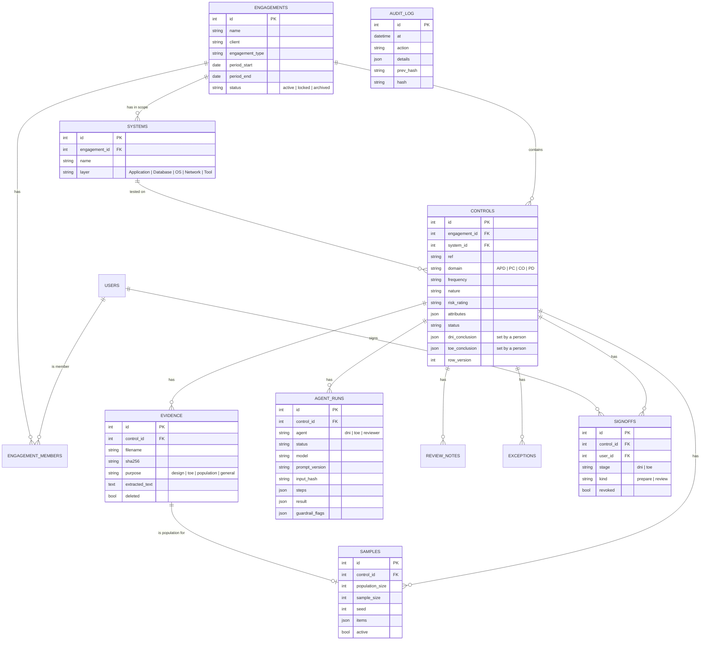

# Data model

All tables are defined in `backend/app/models.py` (SQLAlchemy 2). The same model runs on Postgres and SQLite.

## Diagram

## Tables

| Table | One row is... | Notes |
|---|---|---|
| `users` | A person who can sign in | `role`: viewer, preparer, reviewer, manager, admin. Tracks failed logins and lockout. |
| `engagements` | One audit engagement for one client and period | `status=locked` makes everything read-only |
| `engagement_members` | A user on an engagement | Preparers, reviewers and viewers only see engagements they're members of |
| `systems` | An in-scope application or layer | A library control can be added once per system |
| `controls` | One control tested on one system | A copy of the library template, then tailored. `library_ref` keeps the source. |
| `evidence` | One uploaded file | File on disk is named `<sha256 prefix>_<name>`. Text is stored for the agents. Soft delete only. |
| `samples` | One sample selection | Only one `active` sample per control. Older ones are kept. |
| `agent_runs` | One agent run | Full trace. See [AGENTS.md](AGENTS.md#what-a-run-stores). |
| `review_notes` | One review comment | `source`: human or reviewer_agent. `status`: open, addressed, closed. |
| `exceptions` | One failed test (item × attribute) | `severity`: deficiency, significant, material. `status`: open, accepted, remediated. |
| `signoffs` | One prepare or review sign-off | Never deleted, only marked `revoked` |
| `audit_log` | One action | Append-only and hash-chained. See [SECURITY.md](SECURITY.md#audit-trail). |

## Control statuses

| Status | Meaning |
|---|---|
| `not_started` | Nothing done yet |
| `dni_in_progress` | D&I agent run or D&I conclusion confirmed |
| `dni_prepared` | Preparer signed D&I |
| `dni_reviewed` | Reviewer signed D&I |
| `toe_in_progress` | TOE work started |
| `toe_prepared` | Preparer signed TOE |
| `toe_reviewed` | Reviewer signed TOE. The control is complete. |

## Conclusion values

| Field | Values |
|---|---|
| `dni_conclusion.design` | `effective`, `not_effective`, `insufficient_evidence` |
| `dni_conclusion.implementation` | `implemented`, `not_implemented`, `insufficient_evidence` |
| `toe_conclusion.operating` | `operating_effectively`, `not_operating_effectively`, `insufficient_evidence` |

Each conclusion also stores `rationale`, `run_id`, `overrode_agent` and `confirmed_by`.
